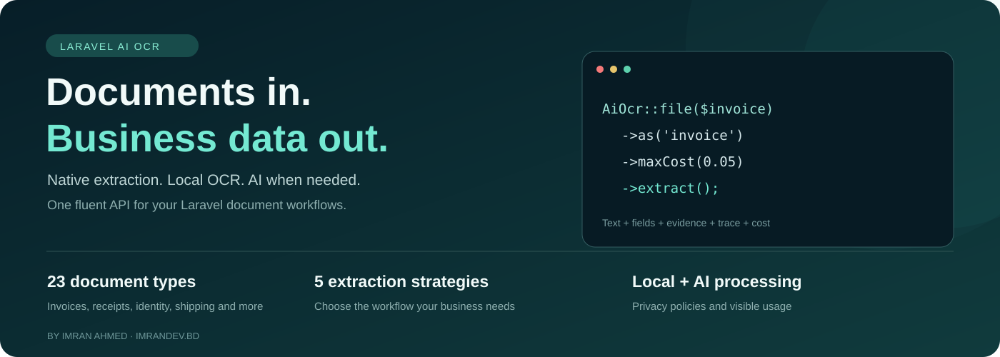
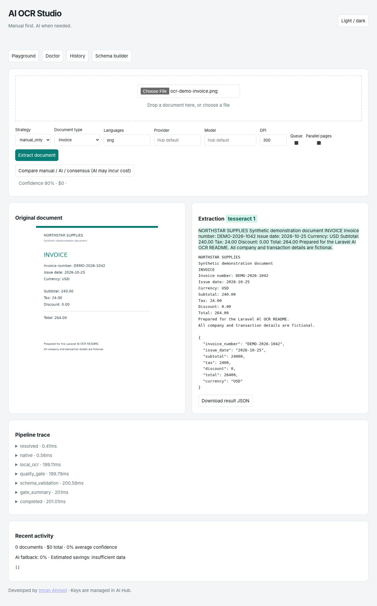
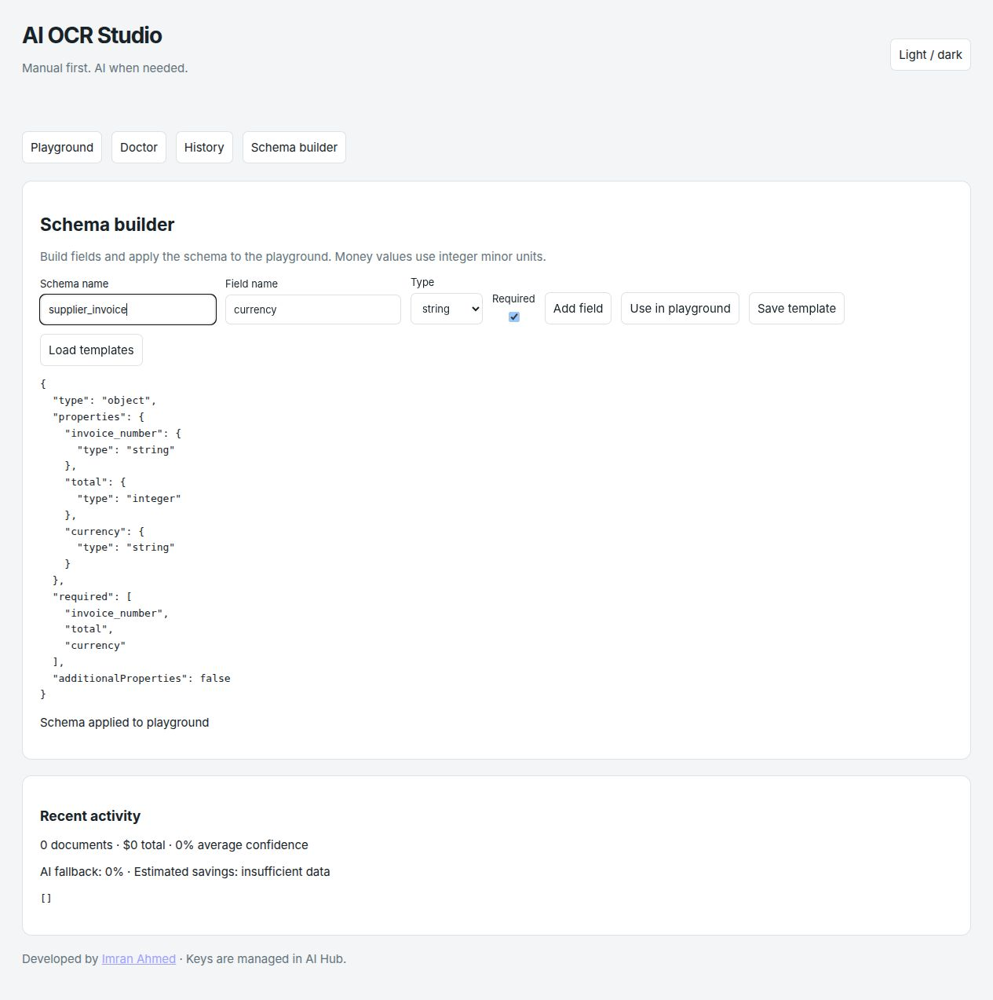
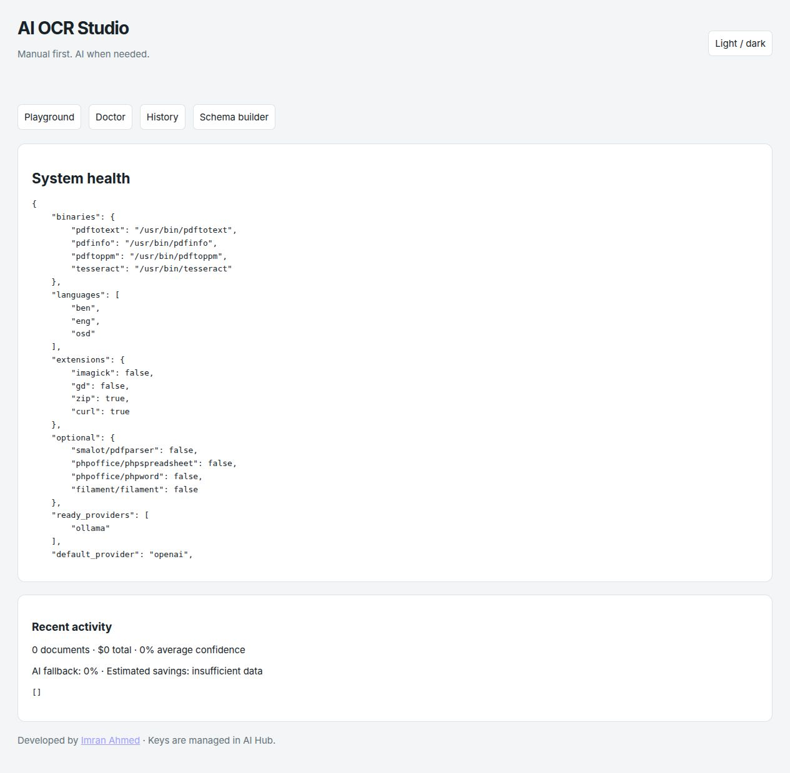
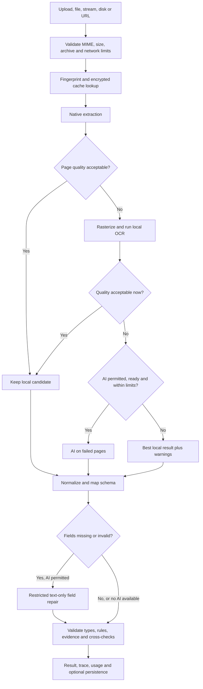

<p align="center">
  
</p>

<h1 align="center">Laravel AI OCR</h1>
<p align="center"><strong>Turn documents into structured, validated data your Laravel application can use.</strong><br>Manual first. AI when needed. Visibility at every step.</p>

<p align="center">
  
  
  
  
</p>

<p align="center">
  <a href="#quick-start">Quick start</a> · <a href="#see-the-studio">Screenshots</a> · <a href="#what-can-your-business-build">Business opportunities</a> · <a href="#how-much-time-could-you-save">Time savings</a> · <a href="#documentation">Documentation</a>
</p>

A supplier sends a PDF. A customer uploads a photograph. Your team receives a folder of receipts, a scanned form, or an email with attachments. Someone still has to open each file, copy its contents, check the numbers, and put the data into your system.

**Laravel AI OCR gives your application a reusable document intake pipeline.** Extract readable text locally, run Tesseract on weak pages, and use AI only where the quality checks say it is needed. Get text, structured fields, validation, confidence, evidence, warnings, and usage through one fluent API.

```php
use ImranDevBd\AiOcr\Facades\AiOcr;

$result = AiOcr::file($request->file('invoice'))
    ->as('invoice')
    ->languages(['ben', 'eng'])
    ->maxCost(0.05)
    ->extract();

$invoice = $result->data();
$totalMinorUnits = $result->field('total')->value;
```

**Release status:** implemented local release candidate; no stable version has been tagged or published. Local checks include fresh Laravel 10–13 installations, 11 PHP/Laravel runtime combinations, Filament 3/4, level-8 static analysis, and the coverage gates described in the [validation report](docs/validation.md). Laravel 13 requires PHP 8.3+. Historical framework compatibility does not imply those dependencies remain secure for production.

## Explore this README

- [Why teams use it](#why-teams-use-it)
- [Business opportunities](#what-can-your-business-build) and [time savings](#how-much-time-could-you-save)
- [Studio screenshots](#see-the-studio)
- [Complete capability map](#complete-capability-map)
- [Formats and inputs](#supported-formats-and-inputs)
- [Installation](#installation) and [quick start](#quick-start)
- [Fallback decisions](#how-manual-first-extraction-works) and [strategies](#choose-your-extraction-strategy)
- [23 document types](#23-built-in-document-types) and [custom schemas](#your-document-your-schema)
- [Results and exports](#results-your-application-can-act-on)
- [Queues, batches and streaming](#queues-batches-and-streaming)
- [Persistence, history and reviews](#persistence-history-and-human-review)
- [Studio, Filament and HTTP API](#studio-filament-and-http-api)
- [Cost, privacy and security](#control-ai-spending-and-data-exposure)
- [Configuration](#configuration-at-a-glance), [CLI](#artisan-commands), [testing](#testing-and-validation)
- [Extending the package](#make-it-fit-your-application), [FAQ](#frequently-asked-questions), [documentation](#documentation)

## Why teams use it

| Your operational problem | What the package provides | The opportunity |
|---|---|---|
| Staff repeatedly retype document fields | Native extraction, local OCR and schema mapping | Spend less time transferring data between systems |
| Every file is sent to a paid model | Local-first processing and targeted fallback | Reserve paid AI calls for difficult pages or fields |
| Different suppliers use different layouts | Built-in types, custom schemas and AI-assisted repair | Build a consistent intake interface around varied documents |
| Important fields disappear inside long text | Typed fields, nested data, tables and exports | Feed business records, search, reports and review screens |
| Operations cannot explain an extracted number | Field confidence, page references, source quotes and trace | Give reviewers context before they accept a value |
| Large uploads hold up web requests | Encrypted jobs, batches, progress and page merging | Move document work into background workflows |
| Sensitive documents need tighter boundaries | Manual-only mode, local-only policy, redaction and encryption | Choose how each class of document can be processed |
| OCR behavior is hard to troubleshoot | Studio, Doctor, warnings, usage and tests | Diagnose missing tools and weak results with visible evidence |

The package handles document extraction. Your Laravel application supplies the business workflow: approvals, ERP posting, customer onboarding, notifications, billing, and application-specific access rules.

## What can your business build?

| Business or team | Example workflow | What you can automate or assist |
|---|---|---|
| Accounting and finance | Invoice or receipt → fields → review → accounting record | Invoice numbers, dates, totals, currencies, line-item candidates and arithmetic checks |
| Retail and e-commerce | Purchase order or supplier invoice → import queue | Reduce repetitive entry into purchasing and stock-management workflows |
| Logistics and distribution | Shipping label, packing list or bill of lading → shipment draft | Extract references, addresses, tracking numbers and item candidates |
| Banks, fintech and onboarding teams | Identity document → restricted extraction → staff review | Bangla/English fields, number-format checks and passport MRZ validation |
| SMEs and agencies | Uploaded receipts and business cards → organized records | Expense intake, contact drafts and searchable document text |
| HR and recruitment | CV or résumé → structured profile draft | Names, contact details, experience and education candidates |
| Clinics and health software teams | Report or prescription → review queue | Prepare structured drafts from patient/report fields; professional review remains part of the host workflow |
| Legal and administration | Contract or form → searchable fields | Capture parties, dates and basic metadata for review and indexing |
| SaaS builders | Customer upload → owned extraction → API response | Add document intake features to an existing Laravel product |
| Internal operations | Legacy files or MIME email attachments → batch import | Consolidate document handling behind one extraction interface |

These are integration opportunities, not bundled accounting, KYC, medical, hiring or legal decision systems. Document type schemas help organize data; they do not establish the truth of a document or replace your review rules.

### A practical route from prototype to production

1. Start with one document family and a small, representative sample set.
2. Run `manualOnly()` to establish the local extraction baseline.
3. Define the fields and checks that make a result usable in your business.
4. Send uncertain records to a review queue; enable narrowly scoped AI fallback where permitted.
5. Measure handling time, correction rate and actual cost before expanding to more suppliers or document types.

## How much time could you save?

The most useful saving is **staff handling time**, not a promise that every page finishes in a fixed number of milliseconds. Replace repeated copying with a workflow where staff review extracted values and resolve exceptions.

The example below assumes **3 minutes of manual handling becomes 45 seconds of review per document**. That saves 2 minutes 15 seconds, or 75% of handling time under those assumptions.

| Documents per month | Manual handling at 3 min each | Review at 45 sec each | Illustrative hours released |
|---:|---:|---:|---:|
| 500 | 25 hours | 6.25 hours | **18.75 hours / month** |
| 2,000 | 100 hours | 25 hours | **75 hours / month** |
| 10,000 | 500 hours | 125 hours | **375 hours / month** |

**Illustrative calculation, not a measured customer result or guaranteed saving.** Your review time depends on document quality, field count, layouts, languages, exception rate and downstream work. Setup, integration, infrastructure, AI charges and ongoing maintenance are additional costs. Staff time released is capacity; it becomes a cash saving only when your business can realize it.

```text
Monthly staff hours released
  = documents × (manual seconds − assisted review seconds) ÷ 3,600

Illustrative monthly labor capacity value
  = hours released × your fully loaded hourly staff cost

Estimated net benefit
  = realized labor value − processing costs − allocated implementation/maintenance costs
```

For the 2,000-document example, **75 hours × $12/hour = $900/month of labor capacity value**, before costs. Substitute your own currency, wage and measured handling times. Use `ai-ocr:benchmark` for pipeline throughput, result usage for AI spend, and a timed business pilot for end-to-end handling savings. OCR confidence alone is not an accuracy measurement.

## See the Studio

These are screenshots of the actual bundled application, captured locally with a **fictional synthetic invoice**. The extraction shown used local Tesseract with **$0 AI spend**. The sample's confidence and duration are specific to that run and are not a performance guarantee.

### Upload a document. Inspect the result. Follow the trace.

Preview the source beside the extracted text and structured JSON. See the engine, word confidence, warnings, cost, and processing steps. Download the result without leaving Studio.



### Define the fields your business needs

Build a schema, apply it to the Playground, and save reusable templates when persistence and an authenticated owner are configured. Nested schemas and advanced rules are also available through the PHP API.



<details>
<summary><strong>View the Doctor screen: binaries, languages, optional dependencies and limits</strong></summary>

Doctor reports the capabilities of the current installation, including missing optional components. It helps you decide what to install for your workload.



</details>

Screenshots are stored in this repository, so GitHub can display them without a running demo server. See [screenshot notes](docs/images/README.md) for their provenance.

## Complete capability map

| Area | Included capabilities |
|---|---|
| Input handling | Uploads, local paths, Laravel storage disks, raw bytes, base64/data URIs, readable PHP streams, PSR streams, public URLs and the media-source contract |
| Native extraction | Poppler PDF text, optional Smalot fallback, conservative minimal PDF fallback, DOCX, XLSX, optional XLS, CSV/TSV, HTML, plain text and recursive MIME email attachments |
| PDF metadata | Page information, best-effort literal AcroForm values and opt-in bounded embedded-image extraction |
| Rasterization | Poppler/Imagick page rendering with configurable DPI and pixel limits; optional multipage TIFF/HEIC support through Imagick |
| Local OCR | Tesseract text, TSV word boxes and confidence, selected language packs, orientation/script information and bounded concurrent processes |
| Preprocessing | Configurable deskew, grayscale and denoise where the installed image backend supports them |
| Quality | Minimum text length, page score, OCR confidence, garbled-text heuristics and expected-script checks |
| AI recovery | Failed-page vision, restricted text-only missing-field repair, semantic retry and fast/strong model escalation |
| Strategies | Auto, manual-only, AI-only, AI verification and weighted field consensus; optional additional consensus models |
| Structured outputs | Fluent or bounded raw JSON schemas, nested objects/arrays, required/nullable fields, enums, regex, custom casts/validators and Laravel rules |
| Business validation | Document-specific cross-checks, money in integer minor units, Bangla digits/dates, BD phone normalization, Luhn/IBAN/MRZ helpers |
| Evidence | Field value, confidence, source page, engine, validation status and source quote; ungrounded AI field evidence is rejected |
| Results | Text, page/word data, tables, structured values, metadata, languages, engine summary, warnings, trace and measured usage |
| Exports | JSON, CSV, Markdown, HTML, table exports and saving to a path or application model |
| Cost management | Page/cost limits, model-price preflight, AI Hub budgets, usage tags, encrypted cache and owner-scoped deduplication |
| Privacy | Manual-only mode, provider allowlists, document-specific local-only policy, reversible text redaction and content-log scrubbing |
| Persistence | Optional ULID document/extraction/page/schema records, encrypted result/text, no-text mode, optional encrypted original retention and pruning |
| Background work | Encrypted jobs, document batches, page batches, ordered merging, callbacks, progress tracking and extraction events |
| Integrations | Laravel facade/helper, Eloquent ownership trait, opt-in HTTP API, signed metadata webhooks and replaceable driver contracts |
| User interface | Blade Studio, upload/drop/preview, strategy controls, compare view, trace, JSON download, schema templates, history/review/rerun and analytics |
| Administration | Eight Artisan commands, Doctor diagnostics and optional Filament 3/4 resource, upload link action and statistics widget |
| Developer experience | Fakes/assertions, synthetic fixtures, offline tests, PHPStan level 8, Pint, coverage gates, Docker and compatibility CI configuration |

Capabilities depend on installed binaries/codecs and the document itself. Native table/field extraction is best-effort; arbitrary complex layouts may require schema-guided AI and review. See [implementation boundaries](docs/implementation-status.md).

## Supported formats and inputs

### File formats

| Document | Processing path | What to install |
|---|---|---|
| Text-based PDF | Native text first; page quality checks; local OCR/AI recovery if needed | Poppler recommended; Smalot optional |
| Scanned or mixed PDF | Page rasterization → local OCR → targeted AI fallback | Poppler or Imagick, plus Tesseract for local OCR |
| JPEG, PNG, WebP, GIF and supported raster images | Local OCR; optional preprocessing and AI vision | Tesseract; Imagick/GD for image processing |
| HEIC and multipage TIFF | Decode/rasterize pages before extraction | Imagick with the required format codecs |
| DOCX | ZIP/XML extraction | PHP ZIP and DOM extensions |
| XLSX | ZIP/XML cells and table data | PHP ZIP and DOM extensions |
| Legacy XLS | Spreadsheet reader | Optional `phpoffice/phpspreadsheet` |
| CSV / TSV | Delimited text and tables | Core PHP capabilities |
| HTML / TXT | Text parsing and cleanup | DOM for HTML |
| EML | MIME body and nested attachments within configured bounds | Format-specific dependencies for each attachment |

MIME detection uses file contents rather than trusting an upload extension. SVG and unsupported formats are rejected. HEIC/TIFF support depends on the actual Imagick build and its security policy.

### Bring documents from the systems you already use

```php
// Laravel upload or a durable local path.
AiOcr::file($request->file('document'))->extract();
AiOcr::file(storage_path('app/private/invoice.pdf'))->extract();

// A configured Laravel disk, including a remote disk with readable streams.
AiOcr::file('invoices/2026-1042.pdf')->disk('s3')->extract();

// Raw bytes, a base64 document, a data URI or a readable stream.
AiOcr::file($bytes)->extract();
AiOcr::file($dataUri)->extract();
AiOcr::file($stream)->extract();

// Public HTTP(S) document URL; SSRF protections apply.
AiOcr::url($publicDocumentUrl)->extract();

// The helper begins a single-file extraction request.
$result = ai_ocr($file)->manualOnly()->extract();
```

PSR streams are detached/consumed by the resolver. Files supplied by application paths are trusted application inputs: never pass an unvalidated request path directly to the filesystem API.

## Installation

### Requirements

- PHP **8.2+**, Laravel **10–13**; Laravel 13 requires PHP 8.3+.
- PHP `fileinfo` and `mbstring`; additional extensions depend on the formats you process.
- Hard AI integration dependency: [`imrandevbd/laravel-ai-hub`](https://github.com/imrandevbd/laravel-ai-hub) **^1.6**, installed by Composer. An AI API key is optional for manual extraction.
- Poppler and Tesseract for the recommended PDF/local OCR workflow.
- Laravel `APP_KEY` for encrypted caches, optional persistence and encrypted queued jobs.

### Install from the current source

Until a stable package version is published, clone/download this repository and use a Composer path repository in your Laravel application:

```bash
composer config repositories.ai-ocr path /absolute/path/to/laravel-ai-ocr
composer require imrandevbd/laravel-ai-ocr:@dev
php artisan ai-ocr:install
```

After publication, normal installation will be:

```bash
composer require imrandevbd/laravel-ai-ocr
php artisan ai-ocr:install
```

Laravel package discovery registers the service provider and facade. The install command publishes configuration/migrations and runs diagnostics; run migrations when you enable persistence.

### Install local document tools

Ubuntu/Debian example:

```bash
sudo apt-get update
sudo apt-get install poppler-utils tesseract-ocr tesseract-ocr-eng tesseract-ocr-ben
php artisan ai-ocr:doctor
```

The [binary installation guide](docs/installation-binaries.md) covers macOS, Windows, Docker, FastPanel/VPS notes, binary paths and language packs. No Node build is required for Studio.

### Choose your starting policy

```dotenv
AI_OCR_STRATEGY=auto
AI_OCR_AI=true
AI_OCR_STORE=false
AI_OCR_STUDIO=false
```

Configure model providers and their credentials in **AI Hub**. OCR does not maintain a second key store. Keep Studio off until its access policy is configured. Use `AI_OCR_AI=false` for a local-only deployment.

## Quick start

### 1. Extract readable text without AI

```php
$text = AiOcr::file($request->file('document'))
    ->manualOnly()
    ->text();
```

No AI account or model key is needed. Available native parsers and Tesseract do the work.

### 2. Create an invoice draft with field validation

```php
$result = AiOcr::file($file)
    ->as('invoice')
    ->validate(['total' => 'required|integer|min:0'])
    ->maxCost(0.05)
    ->extract();

$total = $result->field('total');

if ($result->failed || ! $total->validated || $total->confidence < 0.8) {
    // Send this result to your application's review workflow.
}

// For the USD 264.00 screenshot sample, total is integer 26400.
$totalMinorUnits = $total->value;
```

A validated value passes the configured checks; it is not independent proof that a document is authentic or that every business field is correct. Review the complete result before automatic posting.

### 3. Process Bangla and English identity documents locally

```php
$result = AiOcr::file($nid)
    ->as('bd_nid')
    ->languages(['ben', 'eng'])
    ->manualOnly()
    ->extract();
```

Install `ben.traineddata`. The built-in NID policy also defaults to local-only when AI is enabled; approved local Ollama inference may be available under that policy. Number shape validation is not identity verification.

### 4. Limit work to selected pages

```php
$result = AiOcr::file($largePdf)
    ->pages('1-3,7')
    ->dpi(300)
    ->minConfidence(0.8)
    ->maxCost(0.10)
    ->extract();
```

### 5. Receive a failure result instead of an extraction exception

```php
$result = AiOcr::file($file)->safe()->extract();

if ($result->failed) {
    // Inspect warnings and route the document to an operator.
}
```

Missing AI credentials alone do not make ordinary manual extraction fail. Without an available recovery path, the package returns its best result with honest warnings. Use `requireAi()` when your workflow explicitly requires AI availability.

## How manual-first extraction works



The quality gate considers text length, confidence, garbled sequences and expected script. A legacy Bangla text layer can therefore trigger recovery even when the PDF technically contains selectable text.

For structured recovery, the package restricts the requested schema and checks returned evidence against source pages. AI requests have no tools. A semantic failure can trigger retry or a configured stronger model. [Quality details](docs/quality-gate.md) and [AI Hub source findings](docs/ai-hub-integration.md) explain the boundaries.

## Choose your extraction strategy

| Strategy | Behavior | Useful starting point |
|---|---|---|
| `auto` | Native → local OCR → quality-driven page/field AI fallback | General document intake with controlled fallback |
| `manual_only` | Native and local OCR; no AI requests | Offline processing, sensitive documents, baseline measurement |
| `ai_only` | AI transcription for images/PDFs; parsed text formats supplied as AI input | Testing model-based extraction or AI-specific workflows |
| `ai_verify` | Compare against AI while retaining manual page text and recording differences | Review workflows where a second candidate helps |
| `consensus` | Compare page candidates and use weighted, grounded field agreement | Documents that benefit from multiple extraction candidates |

```php
AiOcr::file($file)->using('ai_verify')->as('invoice')->extract();
AiOcr::file($file)->using('consensus')->as('invoice')->extract();
AiOcr::file($file)->aiOnly()->provider('openai')->model($model)->extract();
```

`withoutAi()` aliases `manualOnly()`. Configure `ai.consensus_models` for additional model votes. Verification and consensus may increase spend and latency; agreement is supporting evidence, not a guarantee of correctness.

## 23 built-in document types

| Family | Registered types | Fields and workflow opportunities |
|---|---|---|
| Purchasing and expenses | `invoice`, `receipt`, `purchase_order`, `utility_bill` | Number, date, subtotal, tax, discount, total, currency, item candidates, seller/buyer |
| Banking | `bank_statement` | Account, bank, period, balances and transaction candidates |
| Payments | `cheque` | Cheque number, bank, payee, amount and date |
| Shipping | `bill_of_lading`, `packing_list`, `shipping_label` | Reference, sender/recipient, address, tracking and items |
| Identity | `bd_nid`, `passport`, `id_card`, `driving_license`, `bd_trade_license` | Type-specific names, numbers and dates; NID shape and passport MRZ checks |
| Contacts and people | `business_card`, `resume`, `cv` | Contact/profile fields, experience and education candidates |
| Legal and health | `contract_basic`, `lab_report`, `prescription` | Basic parties/dates, test values or medication candidates for review |
| General purpose | `table_only`, `generic_key_value`, `handwritten_note` | Rows, key/value entries, or note text and language |

```php
$result = AiOcr::file($file)->as('receipt')->extract();
$result = AiOcr::file($file)->autoDetectType()->extract();
```

Auto-detection uses deterministic text heuristics, then policy-controlled text-only AI for ambiguous documents when available. Unknown files can remain unclassified. Types define extraction targets and checks; difficult line items or layouts may require AI or custom mapping.

## Your document, your schema

Build the structure your application actually needs:

```php
use ImranDevBd\AiOcr\Schema\Schema;

$schema = Schema::make('supplier_invoice')
    ->string('invoice_number')->required()->description('Printed invoice ID')
    ->date('issue_date')->nullable()
    ->money('total')->required()
    ->string('currency')->enum(['BDT', 'USD'])
    ->object('supplier', fn ($s) => $s->string('name')->required())
    ->array('items', fn ($i) => $i
        ->string('description')
        ->number('quantity')
        ->money('amount'));

$result = AiOcr::file($file)
    ->as($schema)
    ->validate(['total' => 'integer|min:0'])
    ->extract();
```

Available features include nested objects/arrays, dotted field names, required/nullable values, enums, descriptions, regex constraints, custom casts and validators, and Laravel validation rules. Casts and custom callbacks disable automatic caching when their semantics cannot be safely fingerprinted.

Raw JSON Schema arrays are accepted through `as($schemaArray)` using a deliberately bounded, locally validated subset. Unknown keys are rejected. Unsupported schema references/combinators fail explicitly rather than being silently ignored. [Schema reference](docs/schemas.md).

### Make numbers and dates usable

- Money is stored in **integer minor units**: `264.00` becomes `26400`, avoiding floating-point ledger arithmetic.
- Bangla digits can normalize into standard numeric values.
- Date and text normalization help reconcile common document representations.
- Built-in invoice checks compare subtotal, tax, discount, total and compatible line-item arithmetic.
- Validation helpers cover BD phone formats, Luhn, IBAN and passport MRZ checks where applicable.

Supply the right currency and application rules before posting financial records.

## Results your application can act on

```php
$result->text();                 // Combined page text
$result->data();                 // Structured values
$result->pages();                // Page objects, engines, words and confidence
$result->tables();               // Extracted table objects
$result->documentType();
$result->language();
$result->metadata();
$result->confidence();
$result->engineSummary();
$result->usedAi();
$result->cost();                 // USD, tokens and latency usage
$result->warnings();
$result->trace();
$result->fromCache();
```

A field carries its review context:

```php
$field = $result->field('total');

$field->value;
$field->confidence;
$field->page;
$field->engine;
$field->source_quote;
$field->validated;
```

Source quotes support textual grounding where available. They do not prove authenticity or eliminate semantic errors. Missing fields can remain unresolved instead of being invented.

### Export and integrate

```php
$json = $result->toJson();
$csv = $result->toCsv();
$markdown = $result->toMarkdown();
$html = $result->toHtml();

$result->save(storage_path('app/private/extraction.json'));

// Your application supplies an ocr_data column/cast on this model.
$result->save($model);
```

Results implement Laravel Arrayable/Jsonable and PHP JsonSerializable, with readonly instance properties and Macroable support. Tables provide array/collection, CSV and Markdown exports. Check [recipes](docs/recipes.md) for application-owned Eloquent mappings; avoid mass-assigning arbitrary extracted values.

## Queues, batches and streaming

### Move work out of the web request

```php
AiOcr::file(storage_path('app/private/upload.pdf'))
    ->as('invoice')
    ->onQueue('ocr')
    ->trackingId('invoice-import-2026-1042')
    ->dispatch();

$progress = AiOcr::progress('invoice-import-2026-1042');
```

```bash
php artisan queue:work --queue=ocr
```

Queued extraction requires a **durable local file path** visible to every worker, a shared `APP_KEY`, and a suitable shared cache for progress. Persist uploads/streams first. Keep source files available through retries. Use `deleteSourceAfterCompletion()` only when the workflow owns that disposable source.

### Batch a folder or parallelize pages

```php
$files = glob(storage_path('app/private/imports/*.pdf'));
AiOcr::files($files)->using('manual_only')->dispatch();

AiOcr::file($largePdf)
    ->as('invoice')
    ->parallel()
    ->dispatch();
```

Document batches use Laravel Bus. Page batches merge in original page order before final schema validation and persistence. Configure Laravel's batch table and workers. Each page worker receives a share of the document AI cap. For local CPU parallelism, increase `ocr.concurrency` to use the bounded Tesseract process pool.

Completion hooks are available through `then()`, `catch()` and `finally()`. Document-batch callbacks follow Laravel Bus signatures; single-extraction callbacks receive the result or exception. Make side effects idempotent across retries.

### Consume page results incrementally

```php
foreach (AiOcr::file($file)->manualOnly()->stream() as $page) {
    // Send progress to your own UI or consume the page.
}
```

Streaming yields pipeline pages before final schema work. Native extraction finishes before the first yield, and final results retain text/trace; this is not a constant-memory promise for arbitrarily large output. Default page limit: 200. A synthetic 300-page regression is documented in [performance](docs/performance.md).

## Persistence, history and human review

Persistence is optional. Enable it when you need durable records and the history/review experience:

```dotenv
AI_OCR_STORE=true
```

```bash
php artisan migrate
```

- ULID document, extraction and page records, plus saved schemas.
- Owner-scoped history and stored-result retrieval.
- Encrypted results and page text by default.
- SHA-based fingerprints and configurable cache/deduplication TTL.
- Optional encrypted original retention for reruns; disabled by default.
- No-text storage mode for deployments that do not need retained page text.
- Human review flags used to calculate reviewed accuracy in analytics.
- Pruning through `ai-ocr:prune`; schedule it in your application.

```php
// Enable original retention only when reruns and your retention policy require it.
config(['ai-ocr.store.retain_original' => true]);

$result = AiOcr::file($file)->ownedBy($customer)->as('invoice')->extract();
```

`HasOcrDocuments` exposes `ocrDocuments`, `ocrExtractions` and an owned `ocr()` request. Media models can implement `Contracts\MediaSource`. Disabling stored text also disables OCR result caching; structured values may still contain sensitive data.

## Studio, Filament and HTTP API

### Studio

Enable `AI_OCR_STUDIO=true` and visit **`/ai-ocr`**. Outside local development, authorize access in an application service provider:

```php
AiOcr::auth(fn ($request) => $request->user()?->can('manage-documents') ?? false);
```

You can also define the `viewAiOcr` Gate or configure role/email allowlists.

| Screen or action | What operators get |
|---|---|
| Playground | Drag/drop upload, preview, strategy, provider/model, type/schema, languages, DPI, sync/queue/page-parallel controls |
| Extraction viewer | Source beside text/JSON, engine badges, confidence-colored words and JSON download |
| Trace | Processing steps, quality decisions, warnings and usage information |
| Compare | Manual, AI and consensus candidates for the same upload; AI calls may incur costs |
| Schema builder | Field definitions, required flags, apply-to-Playground and saved templates |
| History | Owner-scoped filtering, result retrieval/export, review flags and rerun using a different strategy |
| Doctor | Binary paths, installed languages, optional dependencies, provider readiness, queue and limits |
| Analytics | Document count, spend, confidence, fallback rate, per-type reviewed accuracy and estimated AI-only comparison where data supports it |

Saved templates need persistence and an authenticated owner. Reruns need retained originals. Analytics savings extrapolate observed AI cost; they are estimates, not measured labor savings. Studio ships with bundled CSS/plain JavaScript, light/dark mode and no external asset CDN requirement.

### Optional Filament 3/4

Install Filament in your host application and register the plugin on your panel:

```php
->plugin(\ImranDevBd\AiOcr\Filament\AiOcrPlugin::make())
```

The plugin provides authorized Studio navigation; when persistence is enabled it registers an owner-scoped extraction resource and statistics widget. Its upload action opens Studio. Filament is feature-detected and is not a hard runtime dependency.

### Opt-in HTTP API

```php
config(['ai-ocr.api.enabled' => true]);
```

Default API middleware uses `api`, `auth:sanctum` and throttling. Install/configure Sanctum in the host app, or supply your own authenticated middleware policy.

| Method | Default route | Purpose |
|---|---|---|
| POST | `/api/ai-ocr/extract` | Multipart upload; sync result or queued response |
| GET | `/api/ai-ocr/extract/{id}` | Queued progress/result polling |
| GET | `/api/ai-ocr/extractions/{id}` | Owner-scoped stored result |
| POST | `/api/ai-ocr/extractions/{id}/rerun` | Rerun a retained original with an allowed strategy |
| POST | `/api/ai-ocr/extractions/{id}/review` | Save the owner's correctness review |

Upload fields include `file`, `strategy`, `type`, `languages[]`, `dpi`, `provider`, `model`, JSON `schema`, `queued` and `parallel`. A queued response returns an ID and `poll_url`. Stored reads, reviews and reruns require persistence.

### Events and signed webhooks

Listen for extraction start/completion/failure, page extraction, quality-gate failure, AI fallback and budget-block events from `ImranDevBd\AiOcr\Events`.

Optional webhooks send **metadata only**, with timestamp, event ID and HMAC SHA-256 signature. Configure a public HTTPS target and secret; use `Support\WebhookVerifier` for signature/age/replay checks. Receivers should handle retries idempotently. [Webhook recipe](docs/recipes.md#completion-webhooks).

## Control AI spending and data exposure

### Spend AI calls where they can help

```php
$estimate = AiOcr::estimate($file);

$result = AiOcr::file($file)
    ->provider('openai')
    ->model($approvedModel)
    ->maxCost(0.05)
    ->cache(3600)
    ->forJob('invoice-import')
    ->extract();
```

- Readable native text avoids AI page transcription in the automatic strategy.
- Local OCR gets a chance before cloud fallback.
- Vision is restricted to failed pages; missing-field recovery uses restricted text-only requests.
- Configure allowed providers, fast/strong models and maximum AI pages per document.
- Model-price preflight and AI Hub budgets can block a request before it is sent.
- Unknown cloud-model pricing blocks preflight rather than being treated as free.
- Cache hits report zero new cost/tokens. Keys include owner, document, schema/options, model settings and prompt version.
- `noCache()` disables OCR cache and persistent deduplication for that request.

**`maxCost()` is an estimated preflight control, not an atomic billing guarantee.** Provider tokenization, retries and concurrent workers affect real spend. Use provider-side spending limits for a contractual cap, and inspect actual result usage.

### Choose a privacy boundary

| Policy | Behavior |
|---|---|
| `manualOnly()` / `AI_OCR_AI=false` | No AI requests from the extraction pipeline |
| Type-specific `local_only` | AI limited to approved literal loopback/private Ollama endpoints; `bd_nid` defaults to this policy |
| Provider allowlist | Only configured, ready, allowed providers can receive a request |
| `send_text_only` | Blocks image transmission |
| `redact(['nid', 'phone'])` | Reversible text tokens; vision blocked because regex cannot safely redact image pixels |
| Encrypted cache/storage | Laravel encryption protects cached responses and enabled result/text persistence |
| No-content logging | OCR scrubs Hub content previews while retaining approved spend metrics |

OCR stores **no provider keys**. The verified Hub v1.6 settings backend is not encrypted upstream; secure the Hub deployment separately. Local-only inference still depends on the security of your local inference service and infrastructure.

### Input and execution safeguards

Content-based MIME checks, byte/page/pixel limits, ZIP expansion/entry/depth limits, safe XML parsing, private random temporary paths, shell-free process arguments, binary allowlists, time/output bounds, available Linux `prlimit`, DNS-pinned public downloads, disabled redirects/proxies, owner scoping, CSRF and authenticated API defaults form the package's main controls.

They do not replace OS/container isolation or current system binaries. See the [threat model](docs/security.md) and [security reporting policy](SECURITY.md).

## Configuration at a glance

Publish `ai-ocr-config` to customize [config/ai-ocr.php](config/ai-ocr.php). The complete [configuration guide](docs/configuration.md) explains defaults and dependencies.

| Setting | Default | Why you might change it |
|---|---|---|
| `strategy` | `auto` | Choose a different default workflow |
| `limits.max_size_mb` / `max_pages` | 25 / 200 | Match your upload/worker capacity |
| `limits.max_pixels` | 60,000,000 | Bound raster work |
| `ocr.languages` / `dpi` | `['eng']` / 300 | Match document script and scan quality |
| `ocr.concurrency` | 1 | Increase bounded local OCR parallelism |
| `quality.min_score` / `min_chars_per_page` | .75 / 25 | Tune against representative fixtures |
| `ai.max_pages_per_document` | 30 | Limit image fallback breadth |
| `ai.max_cost_per_document` | $0.25 | Set the default estimated AI spending ceiling |
| `ai.cache_ttl` | 86,400 sec | Control repeat-processing reuse |
| `ai.image_max_side` / `image_format` | 1800 / JPEG | Balance image payload size and readability |
| `privacy.policies.bd_nid` | `local_only` | Preserve the intended identity-document boundary |
| `store.enabled` / `retain_original` | false / false | Enable history and optionally reruns |
| `store.encrypt` / `store_text` | true / true | Define retained result/text policy |
| `queue.queue` | `ocr` | Route work to dedicated workers |
| `api.enabled` / `webhooks.enabled` | false / false | Explicitly enable application integrations |

Environment shortcuts include `AI_OCR_STRATEGY`, `AI_OCR_AI`, `AI_OCR_STORE`, `AI_OCR_STUDIO`, `AI_OCR_ROLES`, `AI_OCR_EMAILS` and `AI_OCR_WEBHOOK_SECRET`. Configure the remaining keys through Laravel config, cache it in production, and restart queue workers after changes.

## Fluent API reference

| Task | Methods |
|---|---|
| Begin a request | `file($input)`, `url($url)`, `files($inputs)` |
| Choose processing | `using($strategy)`, `manualOnly()`, `withoutAi()`, `aiOnly()`, `requireAi()` |
| Control AI | `provider($name)`, `model($name)`, `maxCost($usd)`, `forJob($tag)` |
| Scope input | `disk($name)`, `pages('1-3,7')`, `languages([...])`, `dpi(300)`, `preprocess([...])` |
| Define output | `as($typeOrSchema)`, `autoDetectType()`, `validate($rules)`, `minConfidence(.8)` |
| Privacy and reuse | `redact([...])`, `cache($seconds)`, `noCache()`, `ownedBy($model)` |
| Complete synchronously | `extract()`, `text()`, `stream()` |
| Background work | `onQueue($name)`, `trackingId($id)`, `parallel()`, `dispatch()` |
| Hooks and failure handling | `safe()`, `tap($callback)`, `then()`, `catch()`, `finally()` |
| Source lifecycle | `deleteSourceAfterCompletion()` for disposable queued sources |
| Manager utilities | `doctor()`, `estimate($input)`, `progress($id)`, `auth($callback)`, `registerType($type)`, `extend($name, $resolver)`, `driver($name)`, `fake()` |

`files()` returns a BatchRequest with its own smaller API: `using()`, completion hooks, `extract()` and `dispatch()`. It does not expose every single-file option. See the source [ExtractionRequest](src/ExtractionRequest.php) and [BatchRequest](src/BatchRequest.php).

## Artisan commands

| Command | Purpose |
|---|---|
| `ai-ocr:install` | Publish configuration/migrations, run diagnostics and print next steps |
| `ai-ocr:doctor` | Inspect binaries, languages, provider readiness and required extensions |
| `ai-ocr:extract` | Extract a file from the command line |
| `ai-ocr:estimate` | Inspect preflight AI cost estimates |
| `ai-ocr:benchmark` | Measure fixture throughput, cost and confidence |
| `ai-ocr:install-langs` | Print platform-specific language installation guidance |
| `ai-ocr:prune` | Remove records/sources according to retention rules |
| `ai-ocr:types` | List registered document types |

```bash
php artisan ai-ocr:extract /private/invoice.pdf --strategy=auto --type=invoice --lang=ben,eng --json
php artisan ai-ocr:extract /private/invoice.pdf --no-ai
php artisan ai-ocr:estimate /private/invoice.pdf
php artisan ai-ocr:benchmark /private/fixtures
php artisan ai-ocr:install-langs ben eng
php artisan ai-ocr:prune --days=90
```

Benchmarking is manual-only unless you explicitly pass `--ai`, which can incur charges. It reports measured processing throughput and usage; it cannot calculate true extraction accuracy without annotated ground truth. The language command prints instructions rather than silently installing operating-system packages.

## Make it fit your application

- **Custom document types:** subclass `Types\DocumentType`, define a schema, normalize values, add Laravel rules/cross-checks, then `AiOcr::registerType(...)`. [Guide](docs/custom-types.md).
- **Custom drivers:** bind native extraction, OCR, rasterization, AI or readiness contracts in Laravel's container. [Guide](docs/custom-drivers.md).
- **Named extensions:** use `extend()` and `driver()` for application-owned integrations; a named extension does not automatically replace a pipeline contract.
- **Eloquent integration:** map approved values into your own models or use the ownership/media hooks. [Recipes](docs/recipes.md).
- **Review workflow:** use field validation, confidence, warnings and evidence to choose what can proceed and what needs a person.
- **Your product UI:** call the PHP API or protected HTTP API from the admin/customer experience you already have. Studio is optional.

## Testing and validation

### Test your consuming application without running OCR

```php
AiOcr::fake();

// Run the application behavior that requests extraction.
AiOcr::file('sample')->extract();

AiOcr::assertExtracted();
AiOcr::assertExtractedCount(1);
AiOcr::assertNotUsedAi();
```

Supply an `ExtractionResult` or a list of results to `fake()` for realistic application tests. Additional assertions include `assertUsedAi()` and `assertSentToAi($callback)`.

### Run package checks

```bash
composer install
composer check

# With Xdebug or PCOV; load Imagick/GD to exercise optional image branches.
vendor/bin/phpunit --coverage-clover coverage.xml
php tools/check-coverage.php coverage.xml

# Build the production source ZIP and checksum.
php tools/build-release.php
```

| Locally verified check | Result |
|---|---|
| Main suite with optional image codecs | 96 tests, 344 assertions; one optional Filament skip |
| PHP 8.2/8.3/8.4 × supported Laravel 10/11/12/13 combinations | All 11 combinations pass |
| Fresh Laravel application installs | Versions 10, 11, 12 and 13 pass discovery, Doctor and type listing |
| Optional Filament integration | Versions 3 and 4 pass |
| PHPStan / Larastan | Level 8, zero errors on the current toolchain |
| Pint and Composer metadata | Passed |
| Pipeline coverage | 90.33% |
| Quality / Schema / Normalizers / AI driver coverage | 97.73% / 97.12% / 97.03% / 97.98% |

The default tests block stray HTTP calls and use AI Hub fakes. An opt-in `live` suite is separate and requires `AI_OCR_LIVE=true`; it can spend money using configured providers. No billable live-provider calls were made for these validation results.

Historical Laravel 10/11 tests use isolated Composer advisory overrides for dependency resolution. Consumer security defaults remain enabled. The CI workflow defines matrix/coverage/Filament jobs; local success is not a claim that hosted GitHub Actions has run. Full [evidence and reproduction notes](docs/validation.md).

## Frequently asked questions

<details>
<summary><strong>Does every document need an AI API key?</strong></summary>

No. Native parsing and local Tesseract work without one. In automatic mode, unresolved pages/fields remain visible through warnings when no allowed AI provider is available. `requireAi()` is available for workflows that explicitly need AI.

</details>

<details>
<summary><strong>Is local extraction free?</strong></summary>

Native parsing and Tesseract do not incur model API charges. Your server CPU, memory, storage, setup and maintenance still have costs. Optional AI requests are billed by your configured provider.

</details>

<details>
<summary><strong>Does it handle Bangla and legacy Bangla PDFs?</strong></summary>

It supports Bangla Tesseract language packs, digit/date normalization and expected-script/garbled-text heuristics. Weak legacy text layers can trigger raster OCR or allowed AI recovery. It is not a universal Bijoy converter, and difficult scans still need review.

</details>

<details>
<summary><strong>Can it read handwriting and complex tables?</strong></summary>

A handwritten-note type and policy-controlled vision fallback are available. Results depend on legibility, language, model capability and layout. Complex tables may need a custom schema, AI assistance and human correction. No universal accuracy percentage is claimed.

</details>

<details>
<summary><strong>Can I use OpenAI, Gemini, Claude or Ollama?</strong></summary>

Provider integration comes through AI Hub, with credentials, model names and pricing configured there. Choose an appropriate ready provider and model for the requested text/vision capability. OCR applies its own allowlists/privacy checks and disables Hub's unrestricted automatic failover. See the verified integration guide for v1.6 behavior.

</details>

<details>
<summary><strong>Will sensitive documents leave my server?</strong></summary>

Manual-only mode makes no AI requests. Automatic mode can send permitted failed-page images or text for repair. Local-only policies restrict inference endpoints, and redaction blocks vision. Choose the policy for each document class before enabling cloud fallback.

</details>

<details>
<summary><strong>Does confidence mean the value is correct?</strong></summary>

No. Confidence is a heuristic, and a source quote only supports grounding. Combine field checks, cross-checks, representative fixtures and human review. Reviewed accuracy in Studio is based on recorded human correctness flags.

</details>

<details>
<summary><strong>Can it process hundreds of pages?</strong></summary>

The default cap is 200 pages. Limits can be raised after capacity testing; a 300-page synthetic memory regression is included. Raster images are released as work advances, but text and trace accumulate in results. Use dedicated workers, selected pages and batches for large workloads.

</details>

<details>
<summary><strong>What happens when a binary or optional library is missing?</strong></summary>

Doctor reports available capabilities. The pipeline uses supported paths and returns diagnostic warnings or typed failures when the requested capability is unavailable. Reliable PDF text/raster work needs the recommended binaries; no tool can recover every document from missing dependencies.

</details>

<details>
<summary><strong>Can I build a multi-tenant SaaS or charge for document processing?</strong></summary>

The MIT license permits commercial use subject to its terms. Owner-scoped storage, API routes and usage tags are building blocks. Your host app must implement tenant authentication, quotas, billing, worker/storage isolation and customer retention policies. The package does not bundle a SaaS billing system.

</details>

<details>
<summary><strong>How do I upgrade or publish a stable version?</strong></summary>

Review CHANGELOG, preserve local privacy policies when publishing config, run migrations/tests and verify model pricing/capabilities. No stable migration path is claimed before v1.0.0. The release guide explains identity checks, validation, tagging and Packagist submission. This workspace has not published or tagged a stable release.

</details>

## Documentation

| Guide | What it covers |
|---|---|
| [Installation and binaries](docs/installation-binaries.md) | Linux, macOS, Windows, Docker, VPS/FastPanel, Poppler and language packs |
| [Configuration](docs/configuration.md) | All configuration groups, defaults and environment shortcuts |
| [AI Hub integration](docs/ai-hub-integration.md) | Verified dependency source, readiness, image transport, settings and adapters |
| [Schemas and evidence](docs/schemas.md) | Fluent/raw schemas, rules, callbacks and grounded fields |
| [Custom types](docs/custom-types.md) | Application-specific document models and cross-checks |
| [Custom drivers](docs/custom-drivers.md) | Container contracts and extension points |
| [Quality gate](docs/quality-gate.md) | Scoring, garbled text and fallback decisions |
| [Security and privacy](docs/security.md) | Trust boundaries, input controls, logging and residual risks |
| [Performance and cost](docs/performance.md) | Memory, concurrency, caching, budgets and measurement |
| [Application recipes](docs/recipes.md) | Eloquent, invoices, NID, receipts, imports, Filament and webhooks |
| [Validation report](docs/validation.md) | Executed tests, compatibility, coverage and limitations |
| [Implementation boundaries](docs/implementation-status.md) | Deliberate differences and deployment-dependent behavior |
| [Complete file tree](docs/file-tree.md) | Delivered source inventory |
| [Release guide](docs/release.md) | Local checks, source archives, Git tags and Packagist steps |

## Contributing, support and license

Bug reports are most useful with a **synthetic, non-sensitive reproduction**, dependency versions, Doctor output and the relevant warnings/trace. Never attach real identity documents, credentials or confidential customer files to a public issue.

- [Report a bug](https://github.com/imranbru99/laravel-ai-ocr/issues/new?template=bug_report.md)
- [Request a feature](https://github.com/imranbru99/laravel-ai-ocr/issues/new?template=feature_request.md)
- [Contributing guide](CONTRIBUTING.md)
- [Security reporting](SECURITY.md)
- [Changelog](CHANGELOG.md)
- [MIT license](LICENSE)

If this package helps your Laravel project, a GitHub star helps other developers discover it.

---

<p align="center"><strong>Build document workflows that give your team more time for the work that needs them.</strong></p>
<p align="center">Created and maintained by <a href="https://imrandev.bd">Imran Ahmed</a> · <a href="mailto:me@imrandev.bd">me@imrandev.bd</a></p>

## 🤝 Let's Connect & Collaborate

I am open to **Senior Remote Full-Stack Roles**, **AI Platform Architecture Contracts**, and **Enterprise Technical Advisory**.

**Timezone:** UTC+6 (Dhaka / Rangpur, Bangladesh) — Flexible overlap with US, UK, and European business hours.

**Delivery Mode:** Async-ready, Slack, Discord, Jira, GitHub, and production-first accountability.

| Channel | Address / Handle | Quick Action |
|---|---|---|
| 🌐 Primary Portfolio | imrandev.bd | [Visit Site ↗](https://imrandev.bd) |
| 📦 Packagist Packages | packagist.org/packages/imrandevbd/ | [View Packages ↗](https://packagist.org/packages/imrandevbd/) |
| 💼 LinkedIn Profile | linkedin.com/in/imranbru99 | [Connect ↗](https://www.linkedin.com/in/imranbru99) |
| 🐙 GitHub Profile | github.com/imranbru99 | [Follow ↗](https://github.com/imranbru99) |
| 💬 WhatsApp Direct | +880 1576-918420 | [Chat Now ↗](https://wa.me/8801576918420) |
| 📧 Direct Email | me@imrandev.bd | [Send Email ↗](mailto:me@imrandev.bd) |
| 🐦 X (Twitter) | @imrandev_bd | [Follow ↗](https://x.com/imrandev_bd) |
| 📺 YouTube Tech | @ImranDevBD | [Subscribe ↗](https://www.youtube.com/@ImranDevBD) |
