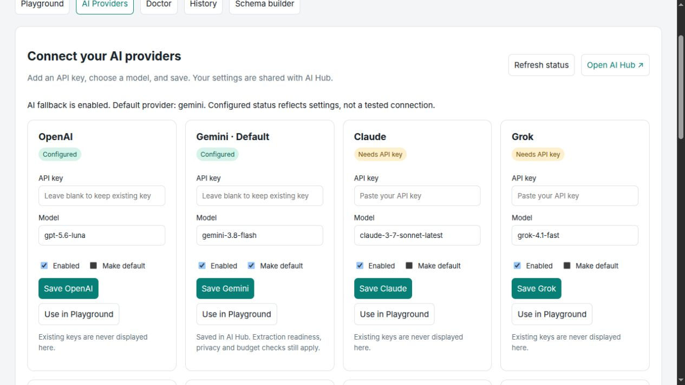

# Visual AI provider configuration

Open **`/ai-ocr` → AI Providers** to enter API keys, choose models, enable/disable
providers and select the AI Hub default without editing a provider configuration
file. The panel uses the providers registered by AI Hub, including OpenAI, Gemini,
Claude, Grok, DeepSeek, Mistral, Groq, Ollama, OpenRouter, Azure OpenAI, Together,
Fireworks and Perplexity in the verified v1.6 installation.



## Enable the panel

In the host Laravel application's `.env`:

```dotenv
AI_OCR_STUDIO=true
AI_HUB_UI=true
AI_OCR_AI=true
```

```bash
php artisan config:clear
php artisan vendor:publish --tag=ai-hub-migrations
php artisan migrate
```

Publishing the Hub migrations lets the configured Hub settings backend use its
database table. Follow the Hub deployment guide for its storage configuration;
OCR does not create a second credential table. If its database table is absent,
Hub v1.6 can fall back to its settings file, which is not encrypted upstream.

## Authorize both interfaces

OCR viewing permission and Hub settings permission are independent. Register
appropriate callbacks in your application's service provider, or use each
package's Gates/role/email policies:

```php
use ImranDevBd\AiHub\Facades\AIHub;
use ImranDevBd\AiOcr\Facades\AiOcr;

AiOcr::auth(fn ($request) =>
    $request->user()?->can('manage-documents') ?? false
);

AIHub::auth(fn ($request) =>
    $request->user()?->can('manage-ai-providers') ?? false
);
```

An OCR operator who lacks Hub settings permission can inspect the OCR interface
but receives an authorization error if they try to save a provider. The form
submits directly to Hub's existing protected provider route with the Laravel
session/CSRF token. It does not proxy or bypass the Hub authorization middleware.
Host applications may require additional middleware; those controls still apply.

## Configure and use a provider

1. Choose a provider card in **AI Providers**.
2. Paste the key into its password field and enter an approved model name.
3. Keep **Enabled** checked; select **Make default** if appropriate.
4. Click **Save**. No model inference request is sent by saving settings.
5. Click **Use in Playground** to fill that extraction's provider/model controls.
6. Restart long-running queue workers after changing shared settings:

   ```bash
   php artisan queue:restart
   ```

Saved keys are never rendered in the OCR page or provider-status response. The
password field clears after a save attempt. Leaving it blank preserves an
existing stored or environment credential. Credentials are stored by AI Hub,
using its configured backend and existing security properties.

**Configured** means that the required configuration is present, not that a live
request has succeeded. **Needs API key**, **Disabled**, and **Blocked for OCR**
explain common states. A blocked provider can still exist in Hub; OCR's provider
allowlist continues to restrict extraction. Local Ollama does not require a
cloud key, but its endpoint/model must be available. Per-document local-only,
redaction, readiness and spending checks still apply when extraction runs.

The panel's **Open AI Hub** link opens advanced Hub settings and its connection
checks; a live connection check may incur provider charges. Configure Azure
endpoints, base URLs, pricing and advanced provider options there or through
Laravel configuration. The panel does not expose a separate endpoint editor.

If Hub UI is disabled or its routes are absent, the panel explains how to enable
it and disables Save buttons. Route URLs are resolved by name, so a custom Hub
route prefix is supported. **Refresh status** reloads configuration summaries
without discarding the document currently selected in Playground.

## Environment-based setup remains available

Set only the providers you intend to use:

```dotenv
AI_HUB_PROVIDER=openai
OPENAI_API_KEY=your-key
# Alternatives:
# GEMINI_API_KEY=your-key
# ANTHROPIC_API_KEY=your-key
```

Do not commit credentials to Git. AI Hub stored settings can override environment
values; inspect the Hub configuration when an environment change appears not to
apply. See [verified integration behavior](ai-hub-integration.md).
